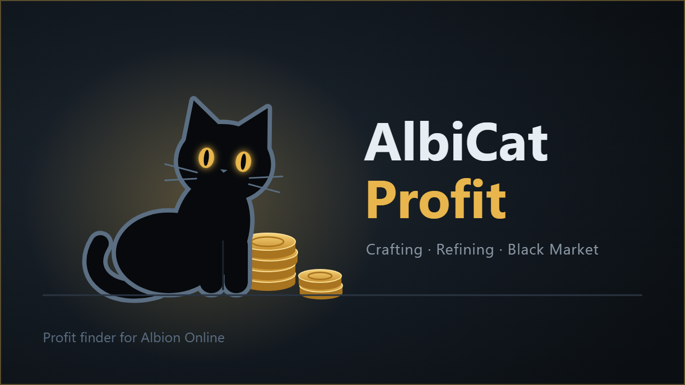

# AlbiCat Profit

**[English](#english)** · **[Русский](#русский)**

## English

A crafting and trading helper for Albion Online. It shows which items are worth crafting, what to buy, where to
carry it and where to sell it: across the five royal cities and Caerleon, including the Black Market.

> The interface is in Russian for now; an English version is in progress. Below, the program's buttons are given
> in English with the Russian label in brackets.

### Features
- **Crafting**: the most profitable items, with your own prices, resource return and focus.
- **Refining**: whether refining pays off in each city.
- **Black Market**: what to carry there and from where.
- **Plan**: step by step "buy, craft, carry, sell", with cargo weight.
- **Calculator**, **Day basket** (routes for your capital), **Orders** and **Journal** (forecast vs. result).

<!-- Screenshot: add a picture of the program window here -->

### Download
Latest version: <https://github.com/AlexInsiderNyx/AlbiCat-Profit/releases/latest>
Download the `AlbiCatProfit-….zip` file.

**Download only from here: there are no other official places, apart from the private post for supporters.**

Check the archive: open PowerShell in the archive's folder and run `Get-FileHash .\AlbiCatProfit-X.zip`
(`X` is the version). Compare the result with the "SHA-256" line in the release notes; letter case does not
matter. If it does not match, do not run it and tell the author.

### First start
1. Unpack the archive anywhere and run `AlbiCat Profit.exe`.
2. Windows may say "Windows protected your PC" or "Unknown publisher": the program is simply not signed with a
   Windows certificate. Click "More info", then "Run anyway".
3. In the welcome window («Добро пожаловать») choose your server (Europe, Americas, Asia) and your capital, then
   click Start («Начать»). The program downloads the game data (about 40 MB) and prices; this takes 1–2 minutes.

### Live prices from the game (optional)
You can connect [Albion Data Client](https://github.com/ao-data/albiondata-client/releases/latest): the prices
you see in the game then reach the program by themselves. You need Npcap and the client itself; in the program
click Connect («Подключить»; administrator rights are needed). Everything works without the client too.

### Updates
New versions arrive by themselves: the Update button («⬆ Обновление»), then «Обновить и перезапустить» (update and
restart). The program installs nothing without the author's signature. This is the program's own update
signature, not a Windows certificate: the exe itself is not signed for Windows.

### Your data, and if something breaks
Data lives in `%LOCALAPPDATA%\AlbiCat Profit`: your profile, own prices, journal and orders survive updates.
If something breaks: Profile («⚙ Профиль»), Data folder: Open («Папка данных: Открыть»), and send the author the
`albicat_profit.log` file.

### What data it uses
Only allowed sources: the game data, the open price server of the Albion Data Project and Albion Data Client.
It does not read the game's memory; no macros, no bots.

### Support the author
The program is free. If it helps you, you can support the author: <!-- link to Boosty/Ko-fi -->
Supporters usually get new versions 1–2 weeks earlier: the early version is in the private post for supporters
and is downloaded by hand. Its archive's SHA-256 is given in the same post.

### Thanks
<!-- supporters' names -->

---

## Русский

Помощник по крафту и торговле для Albion Online. Показывает, какие предметы выгодно делать, что купить,
куда отвезти и где продать: в пяти королевских городах и Карлеоне, в том числе на Чёрный рынок.

### Что умеет
- **Крафт**: самые выгодные предметы с учётом ваших цен, возврата ресурсов и фокуса.
- **Переработка**: выгодна ли переработка ресурсов в каждом городе.
- **Чёрный рынок**: куда и что везти на продажу.
- **План**: пошагово «купить, сделать, отвезти, продать», с учётом веса груза.
- **Калькулятор**, **Корзина дня** (маршруты под ваш капитал), **Ордера** и **Журнал** (прогноз и факт).

<!-- Скриншот: добавьте картинку окна программы сюда -->

### Скачать
Последняя версия: <https://github.com/AlexInsiderNyx/AlbiCat-Profit/releases/latest>
Скачайте файл `AlbiCatProfit-….zip`.

**Скачивайте только отсюда — других официальных мест нет, кроме закрытой записи для поддержавших.**

Проверить архив: откройте PowerShell в папке с архивом и выполните `Get-FileHash .\AlbiCatProfit-X.zip`
(вместо `X` — номер версии). Сравните результат со строкой «SHA-256 архива» в описании выпуска; регистр букв
не важен. Не совпало — не запускайте и напишите автору.

### Первый запуск
1. Распакуйте архив куда угодно и запустите `AlbiCat Profit.exe`.
2. Windows может написать «Windows защитила ваш компьютер» или «Неизвестный издатель»: программа просто
   не подписана. Нажмите «Подробнее», затем «Выполнить в любом случае».
3. В окне «Добро пожаловать» выберите сервер (Европа, Америка, Азия) и капитал, нажмите «Начать».
   Программа скачает данные игры (около 40 МБ) и цены, это займёт 1-2 минуты.

### Живые цены из игры (по желанию)
Можно подключить [Albion Data Client](https://github.com/ao-data/albiondata-client/releases/latest):
цены, которые вы видите в игре, сами попадут в программу. Нужны Npcap и сам клиент; в программе нажмите
«Подключить» (понадобятся права администратора). Без клиента всё тоже работает.

### Обновления
Новые версии приходят сами: кнопка «⬆ Обновление», затем «Обновить и перезапустить».
Программа не установит ничего без подписи автора. Это собственная подпись обновлений, а не сертификат
Windows: сам exe Windows не подписан.

### Ваши данные и если что-то сломалось
Данные лежат в `%LOCALAPPDATA%\AlbiCat Profit`: профиль, свои цены, журнал и ордера сохраняются при
обновлениях. Если что-то сломалось: «⚙ Профиль», «Папка данных: Открыть», и пришлите автору файл `albicat_profit.log`.

### Какие данные использует
Только разрешённые источники: данные игры, открытый сервер цен Albion Data Project и Albion Data Client.
Память игры не читается, макросов и ботов нет.

### Поддержать автора
Программа бесплатная. Если она вам полезна, можно поддержать автора: <!-- ссылка на Boosty/Ko-fi -->
Поддержавшие получают новые версии обычно на 1–2 недели раньше: ранняя версия лежит в закрытой записи для
поддержавших, скачать её нужно вручную. Сумма SHA-256 такого архива указана в той же записи.

### Спасибо
<!-- имена поддержавших -->

---
AlbiCat Profit is not affiliated with Sandbox Interactive GmbH; Albion Online is their trademark.
Программа не связана с Sandbox Interactive GmbH; Albion Online — их товарный знак.
